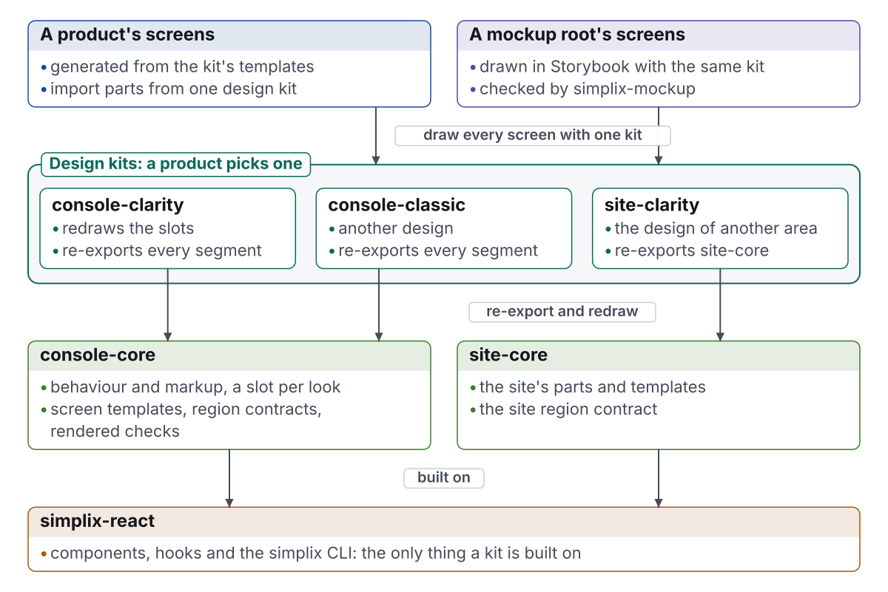

# Kits and Designs

## Overview

An area (an operations console, a customer-facing site) can be drawn in more than one design. If each design were its own set of components, the designs would drift: one would gain a filter the other lacks, and a product could not change its design without rewriting its screens.

The kits separate what a part **does** from how it **looks**. An area's core kit (`console-core`, `site-core`) holds behaviour and markup. A design kit (`console-clarity`, `console-classic`, `site-clarity`) holds one look. A product depends on a design kit and gets every part of the area, drawn in that design.

## How It Works




```text
console-core                          console-clarity
├ src/<segment>/*.tsx   parts         ├ src/<segment>/index.ts   export * from "console-core/<segment>"
├ src/<segment>/*.style.ts  base look ├ src/styles/designs/clarity.spec.ts   redraws the slots
├ src/styles/designs/classic.css      ├ src/styles/designs/clarity.css       generated from the spec
├ templates/            screens       └ defaults: the design ConsoleProviders draws in
├ regions.json          contracts
└ scripts/ · tests/     probes, tests
```

**A slot.** Every element of a part that carries a look is marked with `data-slot`, and its base look is declared beside the part in a `.style.ts` file. The part itself carries no classes of a design. The core's declarations compiled as written are the area's base look (`console-core/src/styles/designs/classic.css`, `site-core/src/styles/designs/base.css`).

**A design.** A design kit redraws slots in a design spec (`src/styles/designs/<design>.spec.ts`). The stylesheet is generated from that spec against the core's declarations (`pnpm design:css`), and `pnpm lint` fails when a generated stylesheet is behind its declarations or leaves a core slot undrawn.

**A segment.** A core kit groups its parts into segments, one per export entry (`/page`, `/entity`, `/shell`, `/notice`, …). A design kit re-exports the core segment by segment and adds only its defaults: the design its providers draw in and the designs it offers the reader.

**Declared once.** A segment is declared in the core kit's `exports`. `node scripts/sync-design-kits.mjs` writes the matching export entry and re-export file into every design kit, and each package's build entries are read from its `exports`.

## Design Decisions

**A design kit holds no component of its own.** A component only one design has is a feature the other designs lack. `sync-design-kits --check` refuses a design kit segment its core kit does not have, and the harness refuses a design kit that exports fewer names than its core.

**The core never names a design kit's design.** The dependency runs one way, so a new design is a new package and no change to the core.

**Every console kit ships every design's stylesheet.** The reader switches design, colour theme, card fill, row density and dark mode at run time from `DisplaySettings` (`/shell`). The kit only decides which design a console opens in.

**The contracts and probes stay in the core.** `regions.json`, `tile-columns.json` and the `*-rendered.mjs` probes describe what a part draws, which is the same in every design, so they live beside the parts.

**A kit names no product.** No brand, logo, domain enum, permission subject or endpoint. A product supplies those through props and providers, so two products share a kit without sharing a line of product code.

## Implications

- You change a part once, in the core kit, and every design has the change.
- You add a design by writing a spec and generating a stylesheet. You write no component.
- A screen imports from the design kit your product depends on (`@simplix-react-ui-kits/console-clarity/entity`). Changing the product's design is a change of that package name.
- A look you need and no slot offers is a missing slot in the core, not a class written in a screen.

> **Next:** [Screen Templates](./screen-templates.md)
