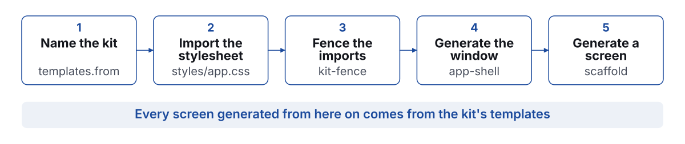

# Quick Start

> After this page a simplix-react product generates a console screen for the `project` entity from the `console-clarity` kit.




## Prerequisites

- A simplix-react product with a domain package that holds the `project` entity. See the framework's quick start for the contract.
- The kit installed. See [Installation](./installation.md).

## Step 1: Name the kit

Tell the CLI which kit the product draws with:

```ts
// simplix.config.ts
import { defineConfig } from "@simplix-react/cli";

export default defineConfig({
  templates: { from: "@simplix-react-ui-kits/console-clarity" },
});
```

Every screen the CLI generates from now on comes from this kit's templates.

## Step 2: Import the stylesheet

```css
/* apps/<app>/src/index.css */
@import "@simplix-react-ui-kits/console-clarity/styles/app.css";

@source "../../../modules/*/src/**/*.{ts,tsx}";
```

## Step 3: Fence the framework imports

A screen composes kit parts, so it must not import the framework components the kit wraps. The kit declares which imports those are, and the CLI writes them into the lint configuration:

```bash
simplix kit-fence --write
```

`simplix kit-fence` without `--write` then fails when the lint configuration and the kit disagree.

## Step 4: Generate the console window

```bash
simplix add-page app-shell console --app <app>
```

This writes the console's window, laid down once and owned by the app from then on: the top bar, the menu column, the search and the routed screen beside them on a wide window, and one screen at a time with phone tabs on a phone. The app's entry wraps it in the kit's `ConsoleProviders` (`/shell`), which takes the app's namespace, locale adapter, auth stack and access policy.

## Step 5: Generate a screen

```bash
simplix scaffold project --module projects
```

This writes the list, the form and the detail of `project`, the page that holds them, its route and its menu entry. Start the app and open the menu entry: the list reads the `project` entity through the hooks the framework derived from the contract.

## Step 6: Shape the screen as its design decided

The scaffold takes the decisions of the screen's design as options:

```bash
simplix scaffold project --module projects \
  --list-presentation cards --card-title name \
  --status-badge status --menu-group work --menu-icon FolderKanban
```

Add `--blocks` to lay down a `page.blocks.tsx` file beside the page. That file is where a screen departs from its template: figures, notices, tabs.

## Summary

The product now names its kit, refuses the imports the kit fences, and generates its screens from the kit's templates.

- Other page kinds (a dashboard, a record page, a static page): [Generate Screens](../guides/generate-screens.md)
- A Storybook of the product's screens: [Create a Mockup Root](../guides/create-a-mockup-root.md)
- Why the templates belong to the core kit: [Screen Templates](../core-concepts/screen-templates.md)
