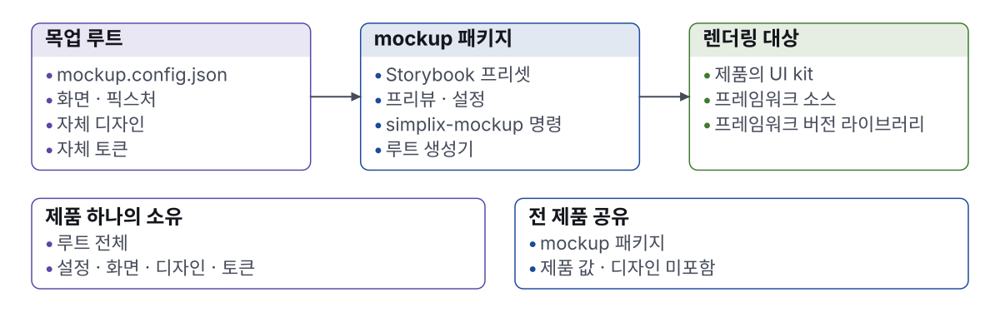

# 목업 루트

## 개요

목업 루트는 제품 화면을 모은 Storybook입니다. 화면마다 스토리 파일이 하나, 상태마다 스토리가 하나 있습니다. 제품이 쓰는 UI kit으로 화면을 그리고 백엔드 대신 픽스처를 사용합니다. 그래서 제품을 만들기 전에 화면을 설계 · 검토 · 캡처할 수 있고, 제품을 만든 뒤에는 제품과 비교할 수 있습니다.

`@simplix-react-ui-kits/mockup`은 목업 루트가 실행하는 도구입니다. 목업 루트에 Storybook 설정, 검사 명령, 새 루트 생성기를 제공합니다.

## 동작 방식



```text
<mockup-root>/
├ package.json         UI kit, mockup 패키지, 프레임워크가 고정한 라이브러리
├ mockup.config.json   uiKit, framework, design, designDirs, locales, 검사 단계, 제품 경로
├ .storybook/          main.ts는 mockup 프리셋을 지정 · preview.tsx는 createMockupPreview() 호출
├ src/index.css        kit의 스타일시트, 그다음 제품의 토큰
├ tokens/              스크립트로 추출한 제품의 디자인 토큰
├ designs/<design>/    프레임워크 컴포넌트를 다르게 그려야 할 때만
├ fixtures/            화면별 샘플 데이터
├ locales/             목업 자체 문구의 번역
└ screens/             화면마다 *.stories.tsx 하나
```

**프리셋**(`@simplix-react-ui-kits/mockup/preset`)은 `mockup.config.json`을 읽고 Vite 플러그인을 추가합니다. 이 플러그인은 루트가 지정한 체크아웃 또는 설치된 패키지에서 프레임워크를 렌더링하고, 루트의 디자인을 적용합니다.

**프리뷰**(`/preview`)는 모든 화면을 프레임워크 provider로 감싸고, 모든 화면에 한꺼번에 적용되는 설정을 툴바에 추가합니다. 상세 표시 방식, 디자인, 색 테마, 카드 채움, 밀도, 모드, 프레임, 로케일이 여기에 해당합니다. 화면은 `useMockupSettings()`(`/settings`)로 이 값을 읽습니다.

**명령**은 루트에서 `simplix-mockup <명령>`으로 실행합니다. `check-screens`는 화면이 kit, React, Storybook 타입, 픽스처와 로케일, 설정 hook 이외의 것을 import하거나 `className`이나 `style`을 쓰면 거부합니다.

## 설계 결정

**모든 화면을 UI kit 하나로 그립니다.** 목업이 프레임워크 컴포넌트를 직접 조합하면 제품이 생성할 수 없는 화면이 됩니다. kit에 화면 유형이 없으면 kit에 추가하고, 목업은 그 유형을 사용합니다. 예외가 필요한 줄 위에는 `// ui-kit-exception: <사유>`를 적으며, 예외는 실행할 때마다 건수를 집계합니다.

**mockup 패키지에는 제품 값과 디자인을 두지 않습니다.** 한 제품에만 해당하는 것은 모두 그 제품의 루트에 있습니다. `mockup.config.json`, 화면, 픽스처가 그렇습니다. 프레임워크 컴포넌트의 디자인 변경도 루트에 두며, `designDirs`에 지정한 디렉터리 안에서 프레임워크 파일과 같은 경로에 둡니다. 공유 패키지에 한 제품의 디자인을 두면 다른 모든 제품이 그 디자인에 묶입니다.

**디자인 재정의는 임시입니다.** 재정의는 프레임워크에 대한 제안입니다. `check-designs`는 프레임워크 파일과 내용이 같은 재정의를 보고합니다. 프레임워크가 채택했다는 뜻이므로 루트에서 삭제합니다. 재정의를 기록한 뒤 프레임워크 파일이 바뀐 경우도 보고하므로, 제안이 프레임워크보다 뒤처진 상태로 남지 않습니다.

**라이브러리 버전은 프레임워크에서 가져옵니다.** 루트는 프레임워크의 소스를 직접 렌더링하므로 프레임워크가 해석한 라이브러리 버전을 설치해야 합니다. `init-mockup`이 프레임워크 체크아웃의 lockfile에서 버전을 읽고, `check-versions`가 이를 비교합니다. mockup 패키지는 버전을 고정하지 않습니다.

**명령은 실행한 루트를 읽습니다.** 프레임워크, 디자인 디렉터리를 비롯한 모든 값은 플래그, 환경 변수, 루트의 `mockup.config.json` 순으로 읽으며, 패키지 자신의 디렉터리에서는 읽지 않습니다. 그래서 패키지를 연결하든, 워크스페이스 구성원으로 두든, 설치하든 똑같이 동작합니다.

## 영향

- 목업 루트는 kit에 의존하는 것과 같은 방식으로 mockup 패키지에 의존합니다. `workspace:*`, `link:` 경로, 배포 버전 중 하나입니다. 둘 다 한 저장소에서 한 번에 릴리스하므로 함께 올리세요.
- 도구를 제품에 복사하지 않습니다. 검사를 고치면 다음 설치 때 모든 제품에 반영됩니다.
- 이 저장소의 `testing/mockup-root`는 kit마다 루트를 생성해 설치, 검사, Storybook 빌드를 실행합니다. 목업 루트를 만들 수 없는 kit은 여기서 먼저 실패합니다.

> **다음:** [콘솔 페이지](./console-pages.md)
