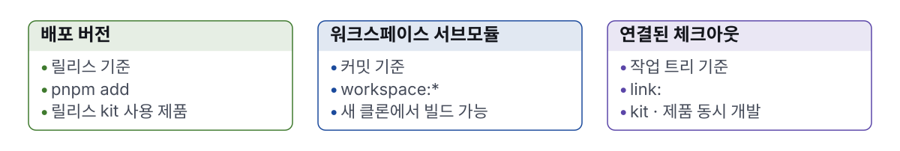

# 설치

> **사전 조건:** simplix-react 제품(`simplix.config.ts`가 있는 pnpm 워크스페이스), Node.js 20 이상, Tailwind CSS 4.

제품이 kit의 변경을 얼마나 빨리 따라가야 하는지에 따라 아래 방법 중에서 선택하세요.

| 방법 | 사용하는 경우 | 제품이 따르는 대상 |
| --- | --- | --- |
| 배포 버전 | 릴리스된 kit으로 제품을 만드는 경우 | 릴리스 |
| 워크스페이스 서브모듈 | 제품이 kit과 함께 바뀌고, 새로 받은 저장소에서도 빌드되어야 하는 경우 | 이 저장소의 커밋 |
| 연결된 체크아웃 | 한 컴퓨터에서 kit과 제품을 함께 개발하는 경우 | 작업 트리 |



## 배포 버전

```bash
pnpm add @simplix-react-ui-kits/console-clarity
pnpm add -D @simplix-react-ui-kits/mockup     # 목업 루트에서만 필요
```

모든 패키지는 저장소의 버전 하나를 공유합니다. 그래서 같은 릴리스의 디자인 kit과 core kit은 항상 서로 맞습니다.

## 워크스페이스 서브모듈

이 저장소를 git 서브모듈로 추가하고, 패키지를 제품의 pnpm 워크스페이스에 포함하세요.

```bash
git submodule add https://github.com/simplix-framework/simplix-react-ui-kits.git vendor/ui-kits
```

```yaml
# pnpm-workspace.yaml
packages:
  - vendor/ui-kits/packages/*
  - vendor/ui-kits/tools/*
```

```json
{
  "dependencies": {
    "@simplix-react-ui-kits/console-clarity": "workspace:*"
  }
}
```

kit은 라이브러리 버전을 `catalog:`로 선언합니다. 제품 워크스페이스 안에서는 이 값을 **제품의** catalog에서 읽으므로, 제품의 `pnpm-workspace.yaml`에 kit이 쓰는 이름이 모두 있어야 합니다. 빠진 이름은 `pnpm install`의 오류 메시지에 표시됩니다.

## 연결된 체크아웃

의존성 경로에 제품 옆의 체크아웃을 지정하세요.

```json
{
  "dependencies": {
    "@simplix-react-ui-kits/console-clarity": "link:../simplix-react-ui-kits/packages/console-clarity"
  },
  "devDependencies": {
    "@simplix-react-ui-kits/mockup": "link:../simplix-react-ui-kits/tools/mockup"
  }
}
```

kit은 `source` export 조건으로 해석됩니다. 제품이 kit의 소스를 직접 읽으므로 kit을 빌드할 필요가 없습니다. 제품의 TypeScript와 Vite 설정에 이 조건을 추가하세요.

```json
{
  "compilerOptions": {
    "customConditions": ["source"]
  }
}
```

## 스타일시트

앱의 스타일시트에서 kit의 스타일시트를 한 번 import하세요.

```css
/* 콘솔 kit의 스타일시트는 Tailwind와 프레임워크 테마를 포함합니다. */
@import "@simplix-react-ui-kits/console-clarity/styles/app.css";
```

```css
/* 사이트 kit은 Tailwind와 프레임워크 테마 뒤에 import합니다. */
@import "tailwindcss";
@import "@simplix-react/ui/theme.css";
@import "@simplix-react-ui-kits/site-clarity/styles/app.css";
```

## 프레임워크 버전

kit은 이 저장소의 catalog에 고정한 simplix-react 버전 하나를 기준으로 만듭니다. 다른 프레임워크 버전을 쓰는 제품은 kit과 함께 컴파일되지 않을 수 있으므로, 두 버전을 함께 올리세요.

> **다음:** [빠른 시작](./quick-start.md)
