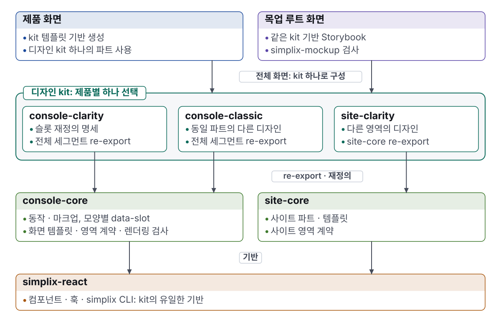

# 개요

## kit의 용도

simplix-react는 제품의 데이터 계층을 contract에서 derive합니다. 클라이언트, hook, mock handler가 여기에 해당합니다. UI 컴포넌트도 제공합니다. 다만 제품 화면 전체의 모양은 정하지 않습니다. 페이지 헤더의 위치, 휴대폰에서 목록이 카드로 바뀌는 방식, 레코드 상세에서 가장 먼저 표시할 항목은 프레임워크가 정하는 범위가 아닙니다.

이 부분은 UI kit에서 정합니다. kit은 디자인 하나를 담은 패키지이며, 제품 화면을 구성하는 페이지 패턴 · 레이아웃 · 공지 · 셸 · 화면 위젯으로 이루어집니다. 제품은 kit 하나를 선택해 모든 화면을 그 kit으로 구성합니다. 화면은 kit 파트를 조합하고 프레임워크 컴포넌트를 직접 배치하지 않습니다. 그래서 한 제품의 두 화면이 서로 달라지지 않고, 같은 kit을 쓰는 두 제품은 같은 방식으로 읽힙니다.

## 저장소 구성

```text
simplix-react-ui-kits/
├ packages/     kit
│  ├ console-core      모든 콘솔 디자인의 공통 파트와 콘솔 화면 템플릿
│  ├ console-classic   클래식 디자인의 콘솔
│  ├ console-clarity   클래리티 디자인의 콘솔
│  ├ site-core         모든 사이트 디자인의 공통 파트와 사이트 템플릿
│  └ site-clarity      클래리티 디자인의 사이트
├ tools/        kit이 아닌 설치형 패키지
│  └ mockup            목업 도구
├ testing/      워크스페이스 자체 검사 (배포하지 않음)
│  ├ template-harness  kit마다 모든 템플릿으로 프로젝트를 생성
│  └ mockup-root       kit마다 목업 루트를 생성
└ scripts/      sync-design-kits.mjs, sync-version.mjs
```

kit의 이름은 `<영역>-<디자인>` 형식입니다. 영역은 제품 화면의 종류(운영 콘솔, 고객용 사이트)입니다. 한 영역에 디자인이 여러 개 있을 수 있고, 한 영역의 모든 디자인은 같은 파트를 제공하며 같은 화면을 생성합니다.

## 구성 요소의 관계



- **제품**은 `simplix.config.ts`의 `templates.from`에 kit을 지정합니다. 그러면 `simplix scaffold`와 `simplix add-page`가 그 kit의 템플릿으로 화면을 생성합니다.
- **목업 루트**는 제품 화면을 모은 Storybook입니다. 제품을 만들기 전이나 제품과 나란히, 같은 kit으로 화면을 그립니다. `@simplix-react-ui-kits/mockup`이 목업 루트를 실행하고 검사합니다.
- **프레임워크**는 kit이 기반으로 삼는 유일한 대상입니다. 디자인이 아닌 코드(포맷, API 헬퍼, 저장소 접근)는 kit이 아니라 simplix-react에 둡니다.

## kit에 두지 않는 항목

- 제품의 이름, 로고, 도메인 enum, 권한 주체, 엔드포인트. 제품이 kit의 props와 provider로 전달합니다.
- 한 디자인에만 있는 컴포넌트. 파트는 core kit에 두고 모든 디자인이 그립니다.
- 한 제품을 위해 다시 그린 프레임워크 컴포넌트. 이것은 디자인 재정의이며, 프레임워크가 채택할 때까지 해당 제품의 목업 루트에 둡니다.

> **다음:** [설치](./installation.md)
