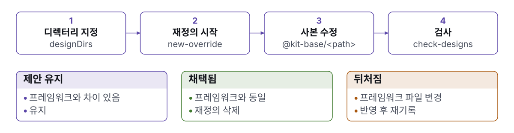

# 프레임워크 디자인 변경 제안하기

> 프레임워크나 kit을 바꾸지 않고 한 제품의 목업에서 프레임워크 컴포넌트를 다르게 그리며, 그 변경이 프레임워크보다 뒤처지지 않게 관리합니다.



## 시작하기 전에

- 목업 루트. [목업 루트 생성](./create-a-mockup-root.md)을 참고하세요.
- `@simplix-react/ui`의 `src` 아래에 있는 프레임워크 파일의 경로. 예: `base/controls/button.tsx`

## 해결 방법

### 1. 디자인 디렉터리 지정

```json
{
  "design": "project",
  "designDirs": ["designs"]
}
```

`design`은 루트가 사용할 디자인입니다. `designDirs`는 루트의 디자인을 두는 디렉터리이며 루트 기준 상대 경로입니다.

### 2. 재정의 시작

```bash
simplix-mockup new-override --design project --file base/controls/button.tsx
```

프레임워크 파일을 `designs/project/ds/base/controls/button.tsx`로 복사하고, 파일의 해시와 리비전을 `designs/project/design.json`에 기록합니다.

### 3. 수정

사본을 수정하세요. 디자인이 활성화된 동안 이 사본이 모든 import에서 프레임워크 파일을 대신합니다. 원본은 `@kit-base/<경로>`로 가져오세요. `@simplix-react/*`로 가져오면 재정의 자신을 다시 가리키게 됩니다.

```tsx
import { Button as FrameworkButton } from "@kit-base/base/controls/button";
```

### 4. 검사

```bash
simplix-mockup check-designs
simplix-mockup check-imports
```

## 변형

### 토큰만 바꾸는 경우

`designs/project/tokens.css`를 프레임워크의 `theme/base.css`처럼 최상위 `:root`와 `.dark` 블록으로 작성하세요. 토큰만 바꾸는 디자인에는 `ds/` 디렉터리가 없습니다.

```css
:root {
  --radius: 0.25rem;
}

.dark {
  --border: oklch(0.32 0 0);
}
```

### 다른 디자인을 기반으로 하는 경우

`design.json`에 `base`를 지정하세요. 선택한 디자인에서 기반 디자인 순으로 재정의를 찾습니다.

```json
{ "name": "project-compact", "base": "project", "overrides": {} }
```

### 프레임워크가 변경을 채택한 경우

`check-designs`가 프레임워크 파일과 내용이 같은 재정의를 보고합니다. 재정의 파일과 `design.json`의 기록을 삭제하세요.

### 프레임워크 파일이 바뀐 경우

`check-designs`가 해당 재정의를 보고합니다. 프레임워크의 변경을 사본에 반영한 뒤, 재정의를 다시 시작하거나 `design.json`의 `frameworkSha256`을 고쳐 새 해시를 기록하세요.

## 관련 문서

- [목업 루트](../core-concepts/mockup-roots.md)
- [`simplix-mockup` 명령](../reference/simplix-mockup-commands.md)
