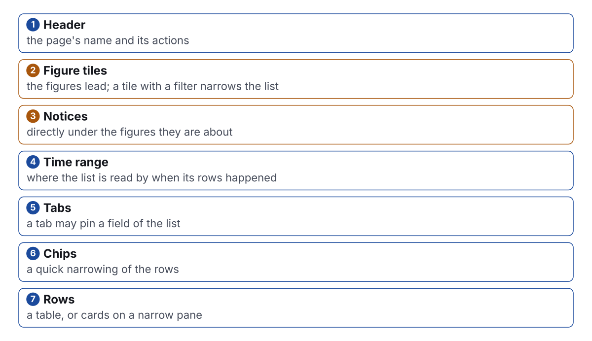

# Console Pages

How a console page is laid out: the order its parts are drawn in, the dashboard grid, and the region contract that says which part fills which region. Read this before composing a console screen or changing a console part.

## Console page order

A console page draws its parts in one order: header, figure tiles, notices, time range, tabs, chips, rows. The figures come first and the page notices sit directly under them, so a notice reads as being about the figures above it. A record's notices sit under its head figures the same way. A screen hands its figures to the page as `spec.tiles`: a count per value is `statusTiles(...)`, and a tile with a `filter` narrows the list under it as its chip does. A page's default figures (`FigureTilesSpec.status`) take `tones`, a status tone per enum value (`tones: { FAILED: "danger" }`): a tile wears its tone only while its count is above zero, so a set the reader must act on is tinted when it has rows and plain when it has none. The figure row has one fold, the console's `TilesCollapse`, shared by every page and remembered as the reader's preference. A row draws as many tiles as fit at the `--tile-min-width` layout token in the page column, up to five (six tiles at full width draw five and one; fewer tiles than columns take the row); `spec.tilesColumns` caps it at one to five. `ConsolePage` holds the order, the kit fence refuses a screen importing `SettingsTiles` or the fold, and `audit-rendered.mjs --check noticesFollowTheStatusCards` refuses a painted page whose notice stands above its figures.

## Dashboard grid

A dashboard page lays its cards out in one `DashboardGrid` (`console-clarity/dashboard`): four columns on a wide page, two on a laptop or a tablet, one on a phone, decided by the grid's own width and the `--dashboard-card-min-width` token, never three. Each `DashboardCard` takes a `span` of 1 (a number or a meter), 2 (a series, a breakdown or a short list) or 4 (a wide table, an event list or a timeline); a span wider than the grid takes the whole row. A page composes its rows so each sums to four and splits into two halves of two (`1 + 1 + 2`, `2 + 1 + 1`, `2 + 2`, `1 + 1 + 1 + 1`, `4`), which keeps every row full at four, two and one columns; `dashboardRowProblems(spans)` names a composition that does not (`1 + 2 + 1`, a span of 3, a last row left short). A card's `action` (and a figure's `action` and `onClick`) takes the list's `href` beside its `onClick`: with it the head is drawn as a link, so the keyboard, a middle click and "open in a new tab" work, and a plain press still runs `onClick` for the router; without it the head is a button. The page chooses spans and nothing else. A dashboard whose figures are what it is for keeps its figure row open with `spec.tilesCollapsible: false`, which draws no fold control. `regions-rendered.mjs` reads the painted grid (`dashboardGrid` in the probe's signature) and `compare` refuses a row that does not reach the grid's edge and a card not as wide as its span (one column, two columns and the gap, or the whole grid, within 1 px); a product's runner reads it at 1440 and 1920.

## Page region contract

`packages/console-core/regions.json` is the authority on what a console page draws where. For each page type (list-detail, dashboard, tabbed, record, system) it names the regions in drawing order, the one part that fills each region, the `page.blocks` slot that feeds it, and the control kinds the region may hold: a row's actions are an icon strip, a list cell holds a value and no control (a reference to another record is a link), a notice card carries at most one action. Every boolean prop of a slot interface is listed there with the reason it changes content rather than look.

`node packages/console-core/scripts/check-regions.mjs` refuses a value part that draws a control and an unlisted boolean slot prop (`pnpm lint`). `packages/console-core/scripts/regions-rendered.mjs` exports `probe`, run inside a painted page, and `compare`, which judges its signature against the page type; a product's runner opens its screens and prints the report. Both prove themselves with `--selftest` (`pnpm test`). `packages/console-core/scripts/tile-columns-rendered.mjs` does the same for the figure tile grid against `tile-columns.json`: `probe` reads every grid as painted, and `compare` and `compareCase` judge it at the page column widths the contract lists.

The keyboard focus ring (`--focus-halo`, a box-shadow outside the control) is kept whole by two tokens next to it: `--focus-gutter`, how far the halo reaches, and `--focus-halo-inset`, the same ring drawn inside the border box. A part that clips the controls it groups (a tab strip, a segmented group, a bar of tabs against the window edge) sets `[--focus-halo:var(--focus-halo-inset)]` in its slot style; a part that only bounds its content takes `-m-[var(--focus-gutter)] p-[var(--focus-gutter)]` (the folding tile row takes it from `tiles-fold`) or `overflow-clip` with `overflow-clip-margin: var(--focus-gutter)`. A control that draws no ring takes `focus-visible:outline-none focus-visible:shadow-[var(--focus-halo)]` in its slot style. `packages/console-core/scripts/focus-clip-rendered.mjs` exports `probe`, run inside a painted page after one real Tab key press: it focuses each control, reads the ring it draws, and reports a ring side that an ancestor clips (an overflow, a `contain: paint`, the window), a ring a later sibling paints over, and a control that draws the browser's default ring. `census` counts the findings by the part that clips so the owner is named. A product's rendered run calls it on every screen, and `--selftest` proves it on a fixture page (`pnpm test`).

> **Next:** [Console Lists](/en/core-concepts/console-lists.md) describes the list a page draws under these parts.

---

<a href="https://github.com/simplix-framework/simplix-react-ui-kits/blob/main/docs/en/core-concepts/console-pages.md" target="_blank" rel="noopener noreferrer">View source</a>

