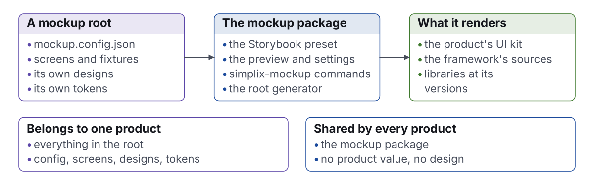

# Mockup Roots

## Overview

A mockup root is a Storybook of a product's screens: one story file per screen, one story per state. It is drawn with the UI kit the product draws with, from fixtures instead of a backend, so a screen can be designed, reviewed and captured before the product is built, and compared with the product afterwards.

`@simplix-react-ui-kits/mockup` is the tooling a mockup root runs. It gives the root three things: a Storybook setup, a set of checks, and a generator of a new root.

## How It Works




```text
<mockup-root>/
├ package.json         the UI kit, the mockup package, the libraries the framework pins
├ mockup.config.json   uiKit, framework, design, designDirs, locales, check stages, product paths
├ .storybook/          main.ts names the mockup preset · preview.tsx calls createMockupPreview()
├ src/index.css        the kit's stylesheet, then the product's tokens
├ tokens/              the product's design tokens, extracted by script
├ designs/<design>/    only where a framework component is to look different
├ fixtures/            sample data per screen
├ locales/             translations of the mockup's own copy
└ screens/             one *.stories.tsx per screen
```

**The preset** (`@simplix-react-ui-kits/mockup/preset`) reads `mockup.config.json` and adds a Vite plugin that renders the framework from the checkout the root names, or from the installed packages, with the root's design applied.

**The preview** (`/preview`) wraps every screen in the framework's providers and adds a toolbar of settings that apply to every screen at once: detail presentation, design, colour theme, card fill, density, mode, frame and locale. A screen reads them with `useMockupSettings()` (`/settings`).

**The commands** run as `simplix-mockup <command>` from the root. `check-screens` refuses a screen that imports anything but its kit, React, Storybook types, its fixtures and locales, and the settings hook, or that writes `className` or `style`.

## Design Decisions

**Every screen is drawn with one UI kit.** A mockup that composes framework components itself shows a screen the product cannot generate. When the kit lacks a screen type, the type is added to the kit, and the mockup then uses it. A screen that must depart carries a `// ui-kit-exception: <reason>` line, and every exception is counted on every run.

**The mockup package holds no product value and no design.** Everything true of one product is in that product's root: its `mockup.config.json`, its screens, its fixtures. A change to a framework component's own design lives in the root too, in a directory `designDirs` names, at the framework file's own path. A shared package that held one product's designs would bind every other product to them.

**A design override is temporary.** It is a proposal to the framework. `check-designs` reports an override identical to the framework file, which means the framework adopted it, and the root then deletes it. It also reports an override whose framework file changed since it was recorded, so a proposal cannot silently fall behind.

**Library versions come from the framework.** A root renders the framework's own sources, so it must install the library versions the framework resolves. `init-mockup` reads them from the framework checkout's lockfile and `check-versions` compares them. The mockup package pins none.

**A command reads the root it runs in.** The framework, the design directories and every other value come from a flag, then the environment, then the root's `mockup.config.json`, never from the package's own directory. The package therefore works the same when it is linked, a workspace member, or installed.

## Implications

- A mockup root depends on the mockup package the way it depends on its kit: `workspace:*`, a `link:` path, or a published version. Both come from one repository and one release, so you move them together.
- You never copy the tooling into a product. A fix to a check reaches every product on the next install.
- `testing/mockup-root` of this repository generates a root for every kit and runs its install, its check and its Storybook build, so a kit that a mockup root cannot be built on fails here first.

> **Next:** [Console Pages](/en/core-concepts/console-pages.md)

---

<p class="page-source"><a href="https://github.com/simplix-framework/simplix-react-ui-kits/blob/main/docs/en/core-concepts/mockup-roots.md" target="_blank" rel="noopener noreferrer">View source</a></p>
