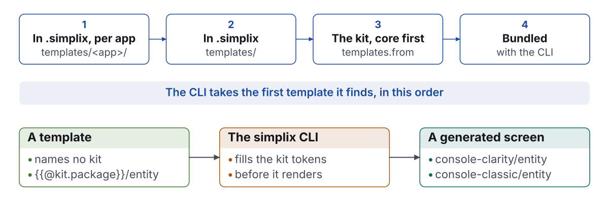
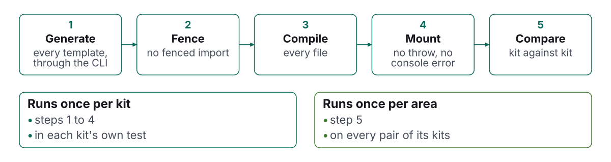

# Screen Templates

## Overview

A product does not write its list, form and detail screens by hand. `simplix scaffold` and `simplix add-page` generate them from templates, and the product then edits what its design asks for. The templates decide what every generated screen of every product on a kit looks like, so they are the most shared code in the repository.

The templates belong to the area's core kit. A design kit has none of its own: it names the core kit it extends, and the CLI reads the core's templates for it.

## How It Works

| Package | Templates |
| --- | --- |
| `console-core` | `templates/`: the CRUD page and its list, form and detail, the TanStack route and menu entry, every page kind (`record-page`, `dashboard-page`, `static-page`, `error-page`, `auth-page`, `app-shell`) and its board frame |
| `site-core` | `templates/`: the site shell, and the site page kinds and their variants |
| A design kit | None. `simplix.extends` names the core kit, `simplix.id` names the kit in the files it generates |

**Resolution.** The CLI looks for a template in this order and takes the first it finds:

1. `.simplix/templates/<app>/` of the product
2. `.simplix/templates/` of the product
3. the kit the app's `templates.from` names, through its `simplix.extends` chain, the core first
4. the template bundled with the CLI




**The kit's name in a template.** A template never writes a kit's name. It writes `{{@kit.package}}` (the package name), `{{@kit.label}}` (the name without the scope) and `{{@kit.id}}`, which the CLI fills in before it renders:

```hbs
import { RecordList } from "{{@kit.package}}/entity";
```

The same template imports from `console-clarity` in one product and from `console-classic` in another.

**The fence.** The imports a screen is refused (`simplix.fence`) are declared once, in the core kit, with the design kit named as `{{@kit.package}}`. `simplix kit-fence` checks a product's lint configuration against it.

## Design Decisions

**Templates per area, not per design.** With a template set per design kit, every template is declared again for each design, and the designs drift apart one fix at a time. With one set per area, every design generates the same screens.

**A failing template means a missing part.** When a template compiles for one kit and fails for another, that kit lacks a part. The kit is fixed. The template is never moved into the kits that pass.

**An override is declared.** A design kit that has to draw one template differently ships that one file in its own `templates/` and names it in `simplix.overrides` with the reason. An undeclared override, or a template only one kit ships, fails the harness.

**Tested by generating.** A template is tested by generating real code through the CLI itself, never through a hand-built rendering context. `testing/template-harness` generates a project from every template for every kit: a domain from a SimpliX Meta snapshot, the CRUD screen with its route and menu entry, and one page of every kind and variant with its board frame. It then:

- refuses any generated import the kit fences
- type-checks every generated file against the router's generated route tree
- mounts every generated board frame, page and shell in a DOM and fails on a throw or a console error
- refuses a design kit that exports less than its core kit
- compares the projects of two kits of one area file by file, with each kit's own values put back as tokens (`parity.mjs`)




## Implications

- You add a template to the core kit, and the harness must be able to generate it: `lib/plan.mjs` assigns each template name the command that renders it and fails on a name it cannot assign.
- A product that needs a different shape puts a template under its own `.simplix/templates/`, not in a kit.
- A generated screen is the product's code from then on. A template change reaches an existing screen only when the product generates it again.

> **Next:** [Mockup Roots](/en/core-concepts/mockup-roots.md)

---

<p class="page-source"><a href="https://github.com/simplix-framework/simplix-react-ui-kits/blob/main/docs/en/core-concepts/screen-templates.md" target="_blank" rel="noopener noreferrer">Edit on GitHub</a></p>
