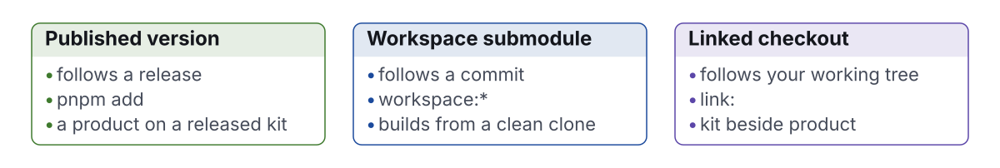

# Installation

> **Prerequisites:** a simplix-react product (a pnpm workspace with `simplix.config.ts`), Node.js 20 or later, and Tailwind CSS 4.

A product takes the kits in one of three ways. Choose by how closely the product follows the kits.

| Way | Use it when | The product follows |
| --- | --- | --- |
| Published version | The product builds on a released kit | A release |
| Workspace submodule | The product changes with the kits and must build from a clean clone | A commit of this repository |
| Linked checkout | You develop the kit and the product side by side on one machine | Your working tree |




## Published version

```bash
pnpm add @simplix-react-ui-kits/console-clarity
pnpm add -D @simplix-react-ui-kits/mockup     # only for a mockup root
```

Every package carries the repository's one version, so a design kit and its core kit of one release always match.

## Workspace submodule

Add the repository as a git submodule and its packages to the product's pnpm workspace:

```bash
git submodule add https://github.com/simplix-framework/simplix-react-ui-kits.git vendor/ui-kits
```

```yaml
# pnpm-workspace.yaml
packages:
  - vendor/ui-kits/packages/*
  - vendor/ui-kits/tools/*
```

```json
{
  "dependencies": {
    "@simplix-react-ui-kits/console-clarity": "workspace:*"
  }
}
```

The kits declare their library versions as `catalog:`. Inside the product's workspace those resolve from the **product's** catalog, so the product's `pnpm-workspace.yaml` must pin every name the kits use. `pnpm install` names a missing one.

## Linked checkout

Point the dependency at a checkout beside the product:

```json
{
  "dependencies": {
    "@simplix-react-ui-kits/console-clarity": "link:../simplix-react-ui-kits/packages/console-clarity"
  },
  "devDependencies": {
    "@simplix-react-ui-kits/mockup": "link:../simplix-react-ui-kits/tools/mockup"
  }
}
```

The kits resolve through their `source` export condition, so the product reads the kit's sources and no build of the kit is needed. Add the condition to the product's TypeScript and Vite configuration:

```json
{
  "compilerOptions": {
    "customConditions": ["source"]
  }
}
```

## The stylesheet

Import the kit's stylesheet once, in the app's stylesheet:

```css
/* A console kit's stylesheet stands alone: it brings Tailwind and the framework theme. */
@import "@simplix-react-ui-kits/console-clarity/styles/app.css";
```

```css
/* The site kit is drawn after Tailwind and the framework theme. */
@import "tailwindcss";
@import "@simplix-react/ui/theme.css";
@import "@simplix-react-ui-kits/site-clarity/styles/app.css";
```

## The framework version

A kit is built against one simplix-react version, pinned in this repository's catalog. A product on another framework version may fail to compile against the kit; move the two together.

> **Next:** [Quick Start](/en/getting-started/quick-start.md)

---

<p class="page-source"><a href="https://github.com/simplix-framework/simplix-react-ui-kits/blob/main/docs/en/getting-started/installation.md" target="_blank" rel="noopener noreferrer">View source</a></p>
