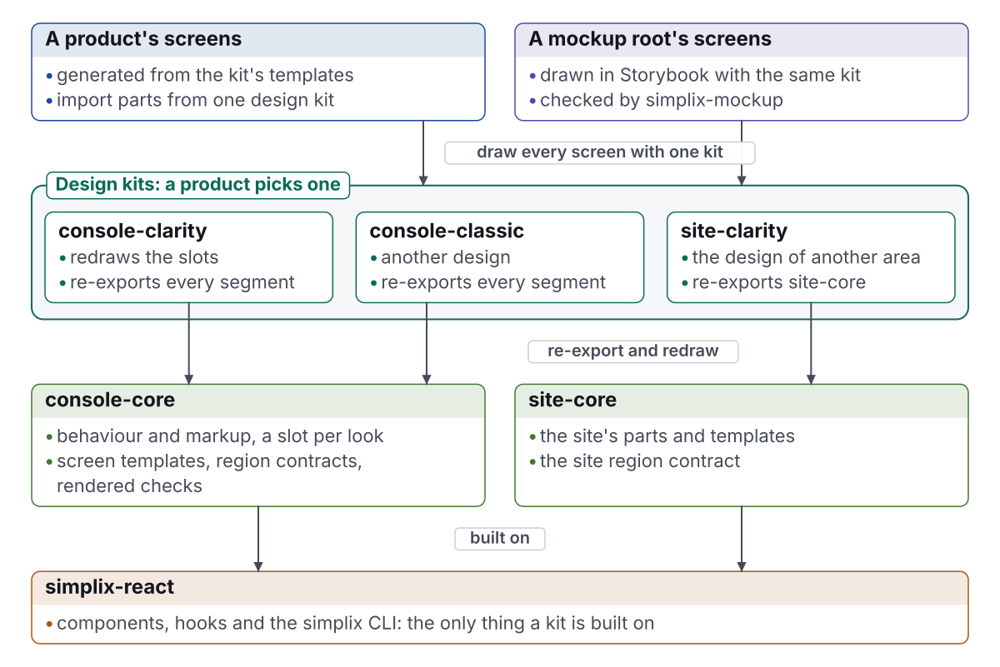

# Overview

## What the kits are for

simplix-react derives a product's data layer from its contract: the client, the hooks, the mock handlers. It also ships UI components. It does not decide what a product's screens look like as a whole: where the page header sits, how a list falls to cards on a phone, what a record's detail draws first.

A UI kit decides that. A kit is a design: the page patterns, layouts, notices, shell and screen widgets a product's screens are composed from. A product picks one kit and draws every screen with it. A screen then composes kit parts and never places a framework component itself, so two screens of one product cannot drift apart, and two products on one kit read the same way.

## What the repository holds

```text
simplix-react-ui-kits/
├ packages/     the kits
│  ├ console-core      what every console design shares, and the console screen templates
│  ├ console-classic   the console in the classic design
│  ├ console-clarity   the console in the clarity design
│  ├ site-core         what every site design shares, and the site templates
│  └ site-clarity      the site in the clarity design
├ tools/        installable packages that are not kits
│  └ mockup            the mockup tooling
├ testing/      the workspace's own checks (never published)
│  ├ template-harness  generates a project from every template, for every kit
│  └ mockup-root       generates a mockup root for every kit
└ scripts/      sync-design-kits.mjs, sync-version.mjs
```

A kit is named `<area>-<design>`. An area is a kind of product surface (an operations console, a customer-facing site). One area can have several designs, and every design of an area has the same parts and generates the same screens.

## How the pieces fit



- **A product** names its kit in `simplix.config.ts` (`templates.from`). `simplix scaffold` and `simplix add-page` then generate its screens from that kit's templates.
- **A mockup root** is a Storybook of the product's screens, drawn with the same kit before or beside the product. `@simplix-react-ui-kits/mockup` runs it and checks it.
- **The framework** stays the only thing a kit is built on. Code that is not design (formatting, API helpers, storage) belongs in simplix-react, not in a kit.

## What a kit never holds

- A product's name, logo, domain enum, permission subject or endpoint. A product supplies those through the kit's props and providers.
- A component that only one design has. A part goes into the core kit, and every design draws it.
- A framework component redrawn for one product. That is a design override, and it lives in the product's mockup root until the framework adopts it.

> **Next:** [Installation](/en/getting-started/installation.md)

---

<p class="page-source"><a href="https://github.com/simplix-framework/simplix-react-ui-kits/blob/main/docs/en/getting-started/overview.md" target="_blank" rel="noopener noreferrer">View source</a></p>
