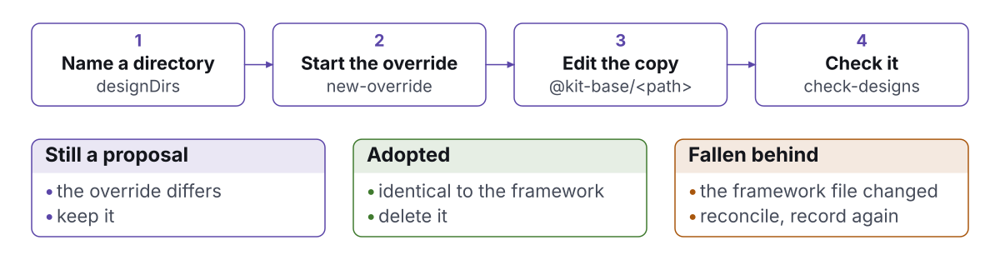

# How to Propose a Framework Design Change

> Make a framework component look different in one product's mockup, without changing the framework or the kit, and keep the change from falling behind the framework.




## Before You Begin

- A mockup root. See [Create a Mockup Root](/en/guides/create-a-mockup-root.md).
- The path of the framework file under `@simplix-react/ui` `src`, for example `base/controls/button.tsx`.

## Solution

### 1. Name a design directory

```json
{
  "design": "project",
  "designDirs": ["designs"]
}
```

`design` is the design the root draws with. `designDirs` are the directories that hold the root's designs, relative to the root.

### 2. Start the override

```bash
simplix-mockup new-override --design project --file base/controls/button.tsx
```

This copies the framework file to `designs/project/ds/base/controls/button.tsx` and records its hash and revision in `designs/project/design.json`.

### 3. Make the change

Edit the copy. It replaces the framework file for every importer while the design is active. Reach the original through `@kit-base/<path>`, never through `@simplix-react/*`, which would route back through the override itself:

```tsx
import { Button as FrameworkButton } from "@kit-base/base/controls/button";
```

### 4. Check it

```bash
simplix-mockup check-designs
simplix-mockup check-imports
```

## Variations

### Change tokens only

Write `designs/project/tokens.css` like the framework's `theme/base.css`, with top-level `:root` and `.dark` blocks. A design that changes only tokens has no `ds/` directory.

```css
:root {
  --radius: 0.25rem;
}

.dark {
  --border: oklch(0.32 0 0);
}
```

### Build on another design

Give `design.json` a `base`. The chain is searched from the selected design down to its bases.

```json
{ "name": "project-compact", "base": "project", "overrides": {} }
```

### The framework adopted the change

`check-designs` reports an override identical to the framework file. Delete the override and its record in `design.json`.

### The framework file changed

`check-designs` reports the override. Carry the framework's change into your copy, then record the new hash by starting the override again or by editing `frameworkSha256` in `design.json`.

## Related

- [Mockup Roots](/en/core-concepts/mockup-roots.md)
- [`simplix-mockup` Commands](/en/reference/simplix-mockup-commands.md)

---

<p class="page-source"><a href="https://github.com/simplix-framework/simplix-react-ui-kits/blob/main/docs/en/guides/propose-a-framework-design-change.md" target="_blank" rel="noopener noreferrer">Edit on GitHub</a></p>
