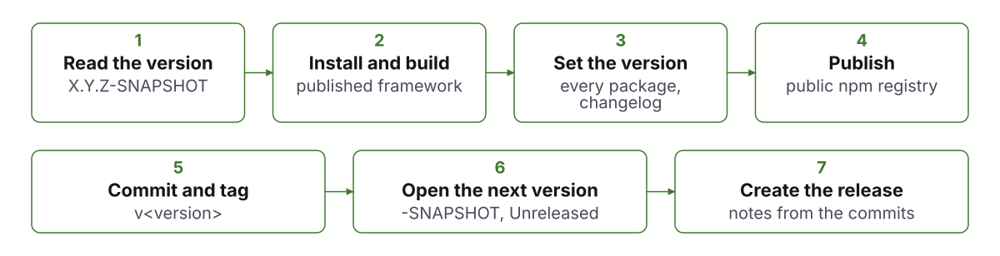

# How to Release

> Publish every package of the repository together, under one version.

## Before You Begin

- The simplix-react version the kits' catalog pins is published. The release installs against the published framework, never a checkout.
- The repository secret `NPM_TOKEN` holds a token with publish rights to the `@simplix-react-ui-kits` scope.
- The root version ends in `-SNAPSHOT`, and the topmost section of `CHANGELOG.md` is marked `Unreleased` and lists what the release ships.

## Solution




Run the `Release` workflow (`.github/workflows/release.yml`) by hand on the branch to release. It:

1. reads the root version `X.Y.Z-SNAPSHOT` and takes `X.Y.Z` as the release version
2. installs against the published framework (`SIMPLIX_PROFILE=registry`), checks the versions and the types, and builds
3. sets the release version in every package and stamps the `Unreleased` section of `CHANGELOG.md` with the version and the date
4. publishes every package that is not `private` to the public npm registry
5. commits and tags `v<version>`
6. sets the next `-SNAPSHOT` version, opens a fresh `Unreleased` section, and commits
7. creates the GitHub release from the commits since the last tag

`pnpm publish` writes each `workspace:*` and `catalog:` dependency as the version it stands for, so a published design kit depends on the published core kit of the same release.

## Variations

### Check the versions locally

```bash
node scripts/sync-version.mjs --check
```

### Move to another version line

```bash
node scripts/sync-version.mjs --set 0.2.0-SNAPSHOT
```

Setting a `-SNAPSHOT` version opens an `Unreleased` section when the changelog has none. Setting a release version stamps the `Unreleased` section and fails when there is none.

### Look at what a package would publish

```bash
pnpm --filter @simplix-react-ui-kits/mockup build
pnpm --filter @simplix-react-ui-kits/mockup pack --pack-destination /tmp/kits-pack
```

## Related

- [Workspace Scripts](/en/reference/workspace-scripts.md)
- [CHANGELOG](https://github.com/simplix-framework/simplix-react-ui-kits/blob/main/CHANGELOG.md)

---

<p class="page-source"><a href="https://github.com/simplix-framework/simplix-react-ui-kits/blob/main/docs/en/guides/release.md" target="_blank" rel="noopener noreferrer">View source</a></p>
