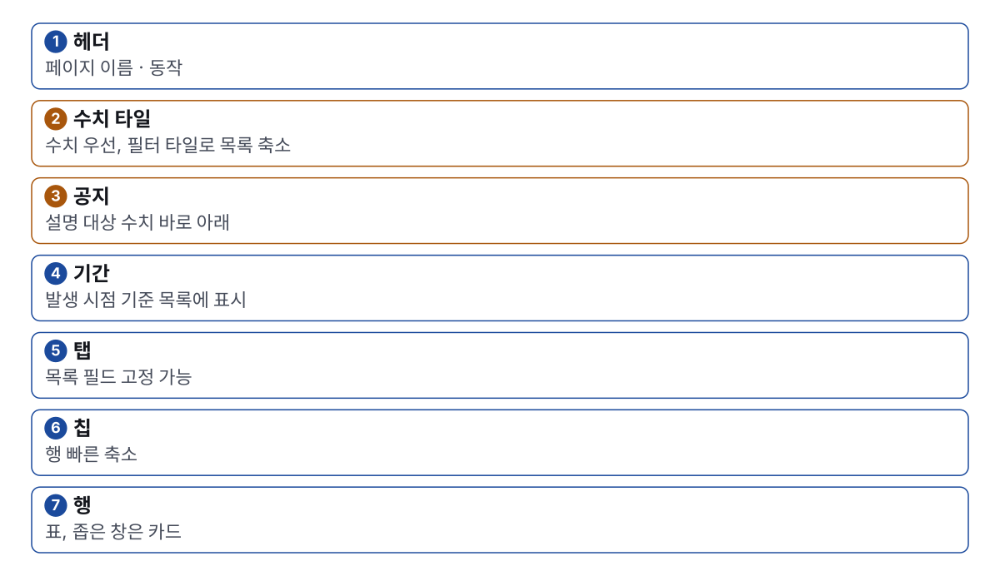

# 콘솔 페이지

콘솔 페이지의 배치를 설명합니다. 파트를 그리는 순서, 대시보드 그리드, 어느 파트가 어느 영역을 채우는지 정한 영역 계약을 다룹니다. 콘솔 화면을 구성하거나 콘솔 파트를 바꾸기 전에 읽으세요.

## 콘솔 페이지 순서

콘솔 페이지는 파트를 한 가지 순서로 그립니다. 헤더, 수치 타일, 공지, 기간, 탭, 칩, 행 순입니다. 수치가 가장 먼저 오고 페이지 공지는 그 바로 아래에 있으므로, 공지는 위에 있는 수치에 대한 설명으로 읽힙니다. 레코드의 공지도 같은 방식으로 헤드 수치 아래에 둡니다. 화면은 수치를 `spec.tiles`로 페이지에 전달합니다. 값별 건수는 `statusTiles(...)`로 만들고, `filter`가 있는 타일은 칩과 마찬가지로 아래 목록을 좁힙니다. 페이지의 기본 수치(`FigureTilesSpec.status`)는 `tones`를 받습니다. `tones`는 enum 값별 상태 색조입니다(`tones: { FAILED: "danger" }`). 타일은 건수가 0보다 클 때만 색조를 표시합니다. 그래서 사용자가 조치해야 하는 집합은 행이 있을 때 색이 입혀지고 없을 때는 기본 모양으로 표시됩니다. 수치 행에는 접기 컨트롤이 하나 있습니다. 콘솔의 `TilesCollapse`이며, 모든 페이지가 공유하고 사용자의 설정으로 기억합니다. 한 행에는 페이지 열 안에서 `--tile-min-width` 레이아웃 토큰 폭으로 들어가는 만큼 타일을 그리며 최대 다섯 개입니다. 전체 폭에서 타일 여섯 개는 다섯 개와 한 개로 나뉘고, 타일 수가 열 수보다 적으면 타일이 행을 나누어 채웁니다. `spec.tilesColumns`로 상한을 1~5로 낮출 수 있습니다. 이 순서는 `ConsolePage`가 정합니다. kit의 import 차단 규칙은 화면이 `SettingsTiles`나 접기 컨트롤을 import하면 거부하고, `audit-rendered.mjs --check noticesFollowTheStatusCards`는 공지가 수치 위에 그려진 페이지를 거부합니다.

## 대시보드 그리드

대시보드 페이지는 카드를 `DashboardGrid`(`console-clarity/dashboard`) 하나에 배치합니다. 넓은 페이지에서는 4열, 노트북이나 태블릿에서는 2열, 휴대폰에서는 1열입니다. 열 수는 그리드 자신의 폭과 `--dashboard-card-min-width` 토큰으로 정해지며 3열은 없습니다. `DashboardCard`의 `span`은 1(숫자나 미터), 2(시계열, 분포, 짧은 목록), 4(넓은 표, 이벤트 목록, 타임라인) 중 하나입니다. 그리드보다 넓은 span은 행 전체를 차지합니다. 페이지는 각 행의 합이 4가 되고 2씩 두 묶음으로 나뉘도록 구성합니다(`1 + 1 + 2`, `2 + 1 + 1`, `2 + 2`, `1 + 1 + 1 + 1`, `4`). 이렇게 하면 4열, 2열, 1열 모두에서 행이 가득 찹니다. `dashboardRowProblems(spans)`는 그렇지 않은 구성(`1 + 2 + 1`, span 3, 모자란 마지막 행)을 반환합니다. 카드의 `action`(그리고 수치의 `action`과 `onClick`)에는 `onClick`과 함께 목록의 `href`를 줄 수 있습니다. `href`가 있으면 헤드를 링크로 그리므로 키보드, 가운데 클릭, "새 탭에서 열기"가 동작하고, 일반 클릭은 라우터용 `onClick`을 실행합니다. `href`가 없으면 헤드는 버튼입니다. 페이지는 span만 정합니다. 수치가 목적인 대시보드는 `spec.tilesCollapsible: false`로 수치 행을 항상 펼쳐 두며, 이때 접기 컨트롤은 그리지 않습니다. `regions-rendered.mjs`는 그려진 그리드를 읽고(프로브 서명의 `dashboardGrid`), `compare`는 그리드 끝까지 닿지 않는 행과 span만큼 넓지 않은 카드(한 열, 두 열과 간격, 그리드 전체, 오차 1px 이내)를 거부합니다. 제품의 실행기는 1440과 1920 폭에서 읽습니다.

## 페이지 영역 계약

`packages/console-core/regions.json`은 콘솔 페이지가 무엇을 어디에 그리는지 정한 기준입니다. 페이지 유형(list-detail, dashboard, tabbed, record, system)마다 그리는 순서대로 영역을 나열하고, 각 영역을 채우는 파트 하나, 그 파트에 값을 주는 `page.blocks` 슬롯, 영역에 둘 수 있는 컨트롤 종류를 적습니다. 행의 동작은 아이콘 묶음이고, 목록 셀은 값만 담고 컨트롤을 담지 않으며(다른 레코드에 대한 참조는 링크), 공지 카드의 동작은 최대 하나입니다. 슬롯 인터페이스의 boolean prop은 모두 이 파일에 있으며, 모양이 아니라 내용을 바꾸는 이유를 함께 적습니다.

`node packages/console-core/scripts/check-regions.mjs`는 컨트롤을 그리는 값 파트와 목록에 없는 boolean 슬롯 prop을 거부합니다(`pnpm lint`). `packages/console-core/scripts/regions-rendered.mjs`는 그려진 페이지 안에서 실행하는 `probe`와, 그 서명을 페이지 유형과 대조하는 `compare`를 export합니다. 제품의 실행기가 화면을 열어 결과를 출력합니다. 둘 다 `--selftest`로 자체 검증합니다(`pnpm test`). `packages/console-core/scripts/tile-columns-rendered.mjs`는 수치 타일 그리드를 `tile-columns.json`과 같은 방식으로 대조합니다. `probe`가 그려진 모든 그리드를 읽고, `compare`와 `compareCase`가 계약에 적힌 페이지 열 폭에서 판정합니다.

키보드 포커스 링(`--focus-halo`, 컨트롤 바깥의 box-shadow)은 옆에 있는 두 토큰으로 잘리지 않게 유지합니다. `--focus-gutter`는 링이 닿는 거리이고, `--focus-halo-inset`은 같은 링을 테두리 상자 안쪽에 그린 것입니다. 묶은 컨트롤을 잘라 내는 파트(탭 줄, 세그먼트 그룹, 창 가장자리에 붙은 탭 바)는 슬롯 스타일에 `[--focus-halo:var(--focus-halo-inset)]`를 지정합니다. 내용의 경계만 정하는 파트는 `-m-[var(--focus-gutter)] p-[var(--focus-gutter)]`를 쓰거나(접히는 타일 행은 `tiles-fold`에서 받음), `overflow-clip`과 `overflow-clip-margin: var(--focus-gutter)`를 씁니다. 링을 그리지 않는 컨트롤은 슬롯 스타일에 `focus-visible:outline-none focus-visible:shadow-[var(--focus-halo)]`를 지정합니다. `packages/console-core/scripts/focus-clip-rendered.mjs`는 `probe`를 export하며, 그려진 페이지에서 실제 Tab 키를 한 번 누른 뒤 실행합니다. 컨트롤마다 포커스를 주고 그려진 링을 읽어, 조상 요소에 잘린 링의 변(overflow, `contain: paint`, 창), 뒤의 형제 요소에 덮인 링, 브라우저 기본 링을 그리는 컨트롤을 보고합니다. `census`는 잘라 내는 파트별로 발견 건수를 집계하므로 고쳐야 할 파트를 확인할 수 있습니다. 제품의 렌더링 실행이 모든 화면에서 이를 호출하고, `--selftest`가 픽스처 페이지로 검증합니다(`pnpm test`).

> **다음:** [콘솔 목록](/ko/core-concepts/console-lists.md)에서 이 파트들 아래에 그리는 목록을 설명합니다.

---

<a href="https://github.com/simplix-framework/simplix-react-ui-kits/blob/main/docs/ko/core-concepts/console-pages.md" target="_blank" rel="noopener noreferrer">GitHub에서 편집</a>

