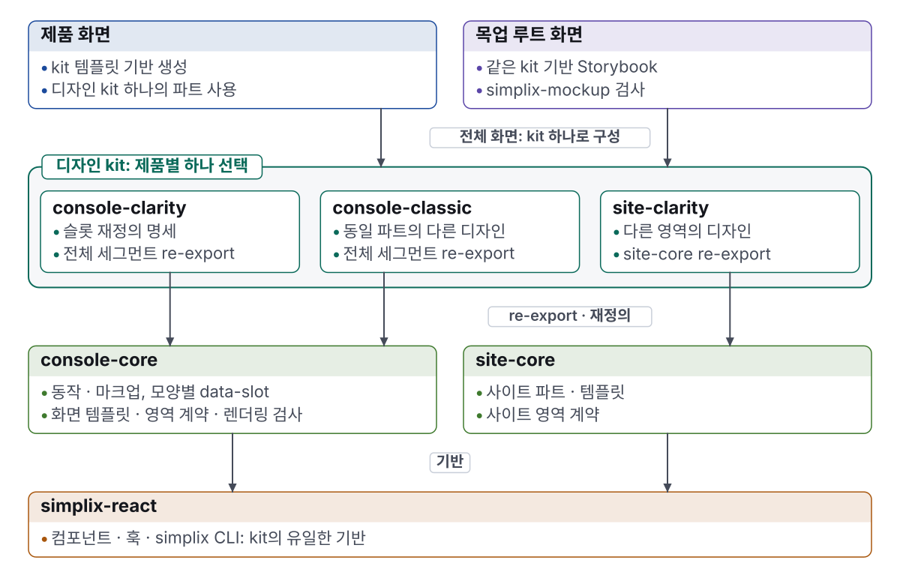

# kit과 디자인

## 개요

영역(운영 콘솔, 고객용 사이트) 하나는 여러 디자인으로 그릴 수 있습니다. 디자인마다 컴포넌트를 따로 만들면 디자인 사이에 차이가 생깁니다. 한 디자인에만 필터가 추가되고, 제품은 화면을 다시 작성하지 않고는 디자인을 바꿀 수 없게 됩니다.

kit은 파트의 **동작**과 **모양**을 분리합니다. 영역의 core kit(`console-core`, `site-core`)에는 동작과 마크업을 둡니다. 디자인 kit(`console-clarity`, `console-classic`, `site-clarity`)에는 모양 하나를 둡니다. 제품은 디자인 kit에 의존하며, 그 디자인으로 그린 영역의 모든 파트를 사용할 수 있습니다.

## 동작 방식



```text
console-core                          console-clarity
├ src/<segment>/*.tsx   파트          ├ src/<segment>/index.ts   export * from "console-core/<segment>"
├ src/<segment>/*.style.ts  기본 모양 ├ src/styles/designs/clarity.spec.ts   슬롯 재정의
├ src/styles/designs/classic.css      ├ src/styles/designs/clarity.css       명세에서 생성
├ templates/            화면          └ 기본값: ConsoleProviders가 사용하는 디자인
├ regions.json          계약
└ scripts/ · tests/     검사, 테스트
```

**슬롯.** 파트 안에서 모양이 있는 요소에는 모두 `data-slot`을 표시하고, 기본 모양은 파트 옆의 `.style.ts` 파일에 선언합니다. 파트 자체에는 디자인의 클래스를 쓰지 않습니다. core의 선언을 그대로 컴파일한 결과가 영역의 기본 모양입니다(`console-core/src/styles/designs/classic.css`, `site-core/src/styles/designs/base.css`).

**디자인.** 디자인 kit은 디자인 명세(`src/styles/designs/<design>.spec.ts`)에서 슬롯을 다시 그립니다. 스타일시트는 이 명세와 core의 선언에서 생성합니다(`pnpm design:css`). 생성된 스타일시트가 선언보다 오래됐거나 core의 슬롯을 그리지 않은 채 두면 `pnpm lint`가 실패합니다.

**세그먼트.** core kit은 파트를 세그먼트로 묶으며, 세그먼트 하나가 export 엔트리 하나입니다(`/page`, `/entity`, `/shell`, `/notice` 등). 디자인 kit은 core의 세그먼트를 하나씩 re-export하고 기본값만 추가합니다. 기본값은 provider가 사용하는 디자인과 사용자에게 제공하는 디자인 목록입니다.

**한 번만 선언.** 세그먼트는 core kit의 `exports`에 선언합니다. `node scripts/sync-design-kits.mjs`가 모든 디자인 kit에 대응하는 export 엔트리와 re-export 파일을 작성하고, 각 패키지의 빌드 엔트리는 `exports`에서 읽습니다.

## 설계 결정

**디자인 kit에는 자체 컴포넌트를 두지 않습니다.** 한 디자인에만 있는 컴포넌트는 다른 디자인에 없는 기능입니다. `sync-design-kits --check`는 core kit에 없는 세그먼트가 있는 디자인 kit을 거부하고, 템플릿 검사 도구(`testing/template-harness`)는 core보다 적은 이름을 export하는 디자인 kit을 거부합니다.

**core는 디자인 kit의 디자인을 참조하지 않습니다.** 의존 방향이 한쪽이므로, 새 디자인은 패키지 하나를 추가하면 되고 core는 바꾸지 않습니다.

**모든 콘솔 kit은 모든 디자인의 스타일시트를 포함합니다.** 사용자는 `DisplaySettings`(`/shell`)에서 디자인, 색 테마, 카드 채움, 행 밀도, 다크 모드를 실행 중에 바꿉니다. kit은 콘솔을 처음 열 때의 디자인만 정합니다.

**계약과 검사는 core에 둡니다.** `regions.json`, `tile-columns.json`, `*-rendered.mjs` 검사는 파트가 그리는 내용을 기술하며, 이 내용은 모든 디자인에서 같습니다. 그래서 파트와 같은 곳에 둡니다.

**kit에는 제품 이름을 쓰지 않습니다.** 브랜드, 로고, 도메인 enum, 권한 주체, 엔드포인트가 없습니다. 제품이 props와 provider로 전달하므로, 여러 제품이 제품 코드를 공유하지 않고도 같은 kit을 씁니다.

## 영향

- 파트는 core kit에서 한 번만 고치면 모든 디자인에 반영됩니다.
- 디자인을 추가할 때는 명세를 작성하고 스타일시트를 생성합니다. 컴포넌트는 작성하지 않습니다.
- 화면은 제품이 의존하는 디자인 kit에서 import합니다(`@simplix-react-ui-kits/console-clarity/entity`). 제품의 디자인을 바꾸려면 이 패키지 이름을 바꿉니다.
- 필요한 모양을 그릴 슬롯이 없다면 core에 슬롯이 빠진 것입니다. 화면에 클래스를 직접 쓰지 마세요.

> **다음:** [화면 템플릿](/ko/core-concepts/screen-templates.md)

---

<p class="page-source"><a href="https://github.com/simplix-framework/simplix-react-ui-kits/blob/main/docs/ko/core-concepts/kits-and-designs.md" target="_blank" rel="noopener noreferrer">GitHub에서 편집</a></p>
