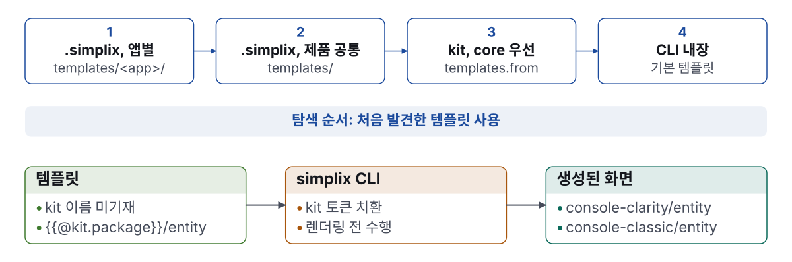
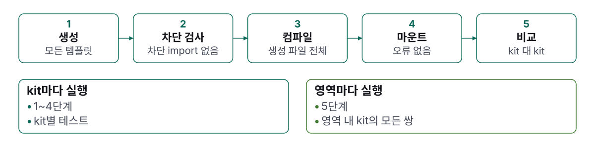

# 화면 템플릿

## 개요

제품은 목록 · 폼 · 상세 화면을 직접 작성하지 않습니다. `simplix scaffold`와 `simplix add-page`가 템플릿에서 화면을 생성하고, 제품은 설계에서 정한 부분만 수정합니다. 한 kit을 쓰는 모든 제품의 생성 화면이 템플릿으로 정해지므로, 템플릿은 이 저장소에서 가장 널리 공유되는 코드입니다.

템플릿은 영역의 core kit에 둡니다. 디자인 kit에는 자체 템플릿이 없습니다. 디자인 kit은 자신이 확장하는 core kit을 지정하고, CLI가 그 core의 템플릿을 읽습니다.

## 동작 방식

| 패키지 | 템플릿 |
| --- | --- |
| `console-core` | `templates/`: CRUD 페이지와 목록 · 폼 · 상세, TanStack 라우트와 메뉴 항목, 모든 페이지 종류(`record-page`, `dashboard-page`, `static-page`, `error-page`, `auth-page`, `app-shell`)와 보드 프레임 |
| `site-core` | `templates/`: 사이트 셸, 사이트 페이지 종류와 변형 |
| 디자인 kit | 없음. `simplix.extends`에 core kit을, `simplix.id`에 생성 파일에 쓰는 kit 이름을 지정 |

**탐색 순서.** CLI는 다음 순서로 템플릿을 찾아 처음 발견한 것을 사용합니다.

1. 제품의 `.simplix/templates/<app>/`
2. 제품의 `.simplix/templates/`
3. 앱의 `templates.from`에 지정한 kit. `simplix.extends`로 이어진 kit을 core부터 읽습니다.
4. CLI에 내장된 템플릿



**템플릿 안의 kit 이름.** 템플릿에는 kit 이름을 직접 쓰지 않습니다. `{{@kit.package}}`(패키지 이름), `{{@kit.label}}`(스코프를 뺀 이름), `{{@kit.id}}`를 쓰며, CLI가 렌더링 전에 값을 채웁니다.

```hbs
import { RecordList } from "{{@kit.package}}/entity";
```

같은 템플릿이 한 제품에서는 `console-clarity`에서, 다른 제품에서는 `console-classic`에서 import하는 코드를 만듭니다.

**import 차단 규칙.** 화면에서 차단하는 import(`simplix.fence`)는 core kit에 한 번 선언하며, 디자인 kit의 이름은 `{{@kit.package}}`로 씁니다. `simplix kit-fence`가 제품의 린트 설정을 이 선언과 대조합니다.

## 설계 결정

**템플릿은 디자인이 아니라 영역 단위로 둡니다.** 디자인 kit마다 템플릿을 두면 같은 템플릿을 디자인 수만큼 선언하게 되고, 수정을 거듭할수록 디자인 사이에 차이가 생깁니다. 영역마다 한 벌만 두면 모든 디자인이 같은 화면을 생성합니다.

**템플릿이 실패하면 kit에 파트가 빠진 것입니다.** 템플릿이 한 kit에서는 컴파일되고 다른 kit에서는 실패한다면, 실패한 kit에 파트가 없는 것입니다. 이때는 kit을 고칩니다. 템플릿을 통과하는 kit 쪽으로 옮기지 않습니다.

**재정의는 선언합니다.** 템플릿 하나를 다르게 그려야 하는 디자인 kit은 그 파일만 자체 `templates/`에 두고, `simplix.overrides`에 사유와 함께 적습니다. 선언하지 않은 재정의나 한 kit에만 있는 템플릿은 템플릿 검사에서 실패합니다.

**생성해서 테스트합니다.** 템플릿은 CLI로 실제 코드를 생성해 테스트합니다. 직접 만든 렌더링 컨텍스트는 쓰지 않습니다. `testing/template-harness`는 kit마다 모든 템플릿으로 프로젝트를 생성합니다. SimpliX Meta 스냅샷으로 만든 도메인, 라우트와 메뉴 항목을 포함한 CRUD 화면, 모든 종류와 변형의 페이지와 보드 프레임이 대상입니다. 생성 후에는 다음을 수행합니다.

- 생성된 코드에 kit이 차단한 import가 있으면 거부합니다.
- 생성된 모든 파일을 라우터가 생성한 라우트 트리와 함께 타입 검사합니다.
- 생성된 모든 보드 프레임 · 페이지 · 셸을 DOM에 마운트하고, 예외나 콘솔 오류가 나면 실패 처리합니다.
- core kit보다 적게 export하는 디자인 kit을 거부합니다.
- 한 영역의 두 kit이 생성한 프로젝트를 파일 단위로 비교합니다. 이때 각 kit 고유의 값은 토큰으로 되돌려 놓고 비교합니다(`parity.mjs`).



## 영향

- 템플릿은 core kit에 추가하며, 템플릿 검사 도구가 그 템플릿을 생성할 수 있어야 합니다. `lib/plan.mjs`가 템플릿 이름마다 렌더링 명령을 지정하고, 지정할 수 없는 이름이 있으면 실패합니다.
- 다른 형태가 필요한 제품은 kit이 아니라 제품의 `.simplix/templates/`에 템플릿을 둡니다.
- 생성된 화면은 그 시점부터 제품의 코드입니다. 템플릿 변경은 제품이 화면을 다시 생성해야 기존 화면에 반영됩니다.

> **다음:** [목업 루트](/ko/core-concepts/mockup-roots.md)

---

<p class="page-source"><a href="https://github.com/simplix-framework/simplix-react-ui-kits/blob/main/docs/ko/core-concepts/screen-templates.md" target="_blank" rel="noopener noreferrer">원본 보기</a></p>
