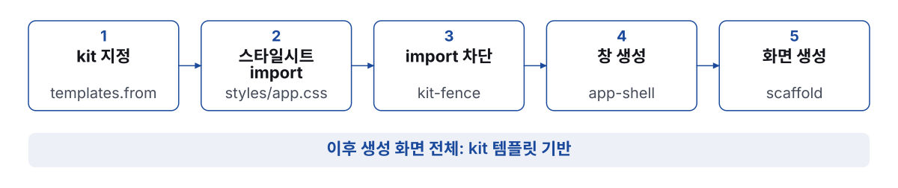

# 빠른 시작

> 이 문서를 마치면 simplix-react 제품이 `console-clarity` kit으로 `project` 엔티티의 콘솔 화면을 생성합니다.



## 사전 조건

- `project` 엔티티가 들어 있는 도메인 패키지를 갖춘 simplix-react 제품. contract 작성은 프레임워크의 빠른 시작을 참고하세요.
- 설치된 kit. [설치](/ko/getting-started/installation.md)를 참고하세요.

## 1단계: kit 지정

제품이 사용할 kit을 CLI 설정에 지정하세요.

```ts
// simplix.config.ts
import { defineConfig } from "@simplix-react/cli";

export default defineConfig({
  templates: { from: "@simplix-react-ui-kits/console-clarity" },
});
```

이후 CLI가 생성하는 모든 화면은 이 kit의 템플릿으로 만들어집니다.

## 2단계: 스타일시트 import

```css
/* apps/<app>/src/index.css */
@import "@simplix-react-ui-kits/console-clarity/styles/app.css";

@source "../../../modules/*/src/**/*.{ts,tsx}";
```

## 3단계: 프레임워크 import 차단

화면은 kit 파트를 조합하므로, kit이 감싼 프레임워크 컴포넌트를 직접 import하면 안 됩니다. 어떤 import가 차단 대상인지는 kit이 선언하고, CLI가 이를 린트 설정에 기록합니다.

```bash
simplix kit-fence --write
```

`--write` 없이 `simplix kit-fence`를 실행하면, 린트 설정과 kit의 선언이 다를 때 실패합니다.

## 4단계: 콘솔 창 생성

```bash
simplix add-page app-shell console --app <app>
```

콘솔 창을 한 번 생성하며, 이후에는 앱이 이 파일을 소유합니다. 넓은 창에서는 상단 바, 메뉴 열, 검색, 그 옆의 라우트 화면을 그리고, 휴대폰에서는 화면을 하나씩 표시하며 하단에 탭을 둡니다. 앱의 진입점에서 이 창을 kit의 `ConsoleProviders`(`/shell`)로 감싸세요. `ConsoleProviders`는 앱의 namespace, 로케일 어댑터, 인증 스택, 접근 정책을 받습니다.

## 5단계: 화면 생성

```bash
simplix scaffold project --module projects
```

`project`의 목록 · 폼 · 상세, 이를 담는 페이지, 라우트, 메뉴 항목을 생성합니다. 앱을 실행하고 메뉴 항목을 열면, 프레임워크가 contract에서 derive한 hook으로 목록이 `project` 엔티티를 조회합니다.

## 6단계: 화면 설계 결정 반영

스캐폴드는 화면 설계에서 정한 내용을 옵션으로 받습니다.

```bash
simplix scaffold project --module projects \
  --list-presentation cards --card-title name \
  --status-badge status --menu-group work --menu-icon FolderKanban
```

`--blocks`를 추가하면 페이지 옆에 `page.blocks.tsx` 파일을 만듭니다. 화면이 템플릿과 달라지는 부분(수치, 공지, 탭)을 이 파일에 작성합니다.

## 정리

제품이 kit을 지정했고, kit이 차단한 import를 린트로 막으며, kit의 템플릿으로 화면을 생성합니다.

- 다른 종류의 페이지(대시보드, 레코드 페이지, 정적 페이지): [화면 생성](/ko/guides/generate-screens.md)
- 제품 화면의 Storybook: [목업 루트 생성](/ko/guides/create-a-mockup-root.md)
- 템플릿을 core kit에 두는 이유: [화면 템플릿](/ko/core-concepts/screen-templates.md)

---

<p class="page-source"><a href="https://github.com/simplix-framework/simplix-react-ui-kits/blob/main/docs/ko/getting-started/quick-start.md" target="_blank" rel="noopener noreferrer">GitHub에서 편집</a></p>
