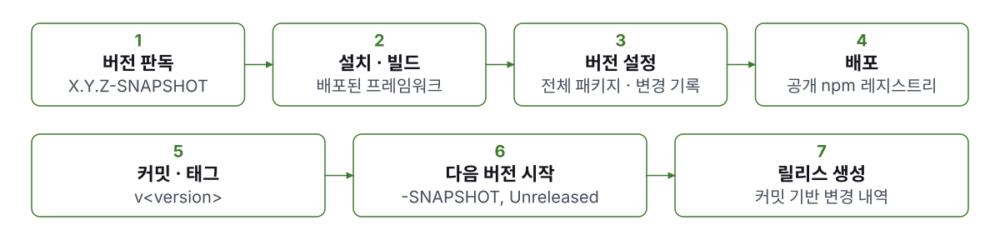

# 릴리스하기

> 저장소의 모든 패키지를 같은 버전으로 함께 배포합니다.

## 시작하기 전에

- kit의 catalog가 고정한 simplix-react 버전이 배포되어 있어야 합니다. 릴리스는 체크아웃이 아니라 배포된 프레임워크로 설치합니다.
- 저장소 시크릿 `NPM_TOKEN`에 `@simplix-react-ui-kits` 스코프의 배포 권한이 있는 토큰이 있어야 합니다.
- 루트 버전이 `-SNAPSHOT`으로 끝나고, `CHANGELOG.md`의 맨 위 섹션이 `Unreleased`이며 릴리스에 포함할 내용이 적혀 있어야 합니다.

## 해결 방법



릴리스할 브랜치에서 `Release` 워크플로(`.github/workflows/release.yml`)를 수동으로 실행하세요. 워크플로는 다음을 수행합니다.

1. 루트 버전 `X.Y.Z-SNAPSHOT`을 읽고 `X.Y.Z`를 릴리스 버전으로 정합니다.
2. 배포된 프레임워크로 설치하고(`SIMPLIX_PROFILE=registry`), 버전과 타입을 검사한 뒤 빌드합니다.
3. 모든 패키지에 릴리스 버전을 설정하고, `CHANGELOG.md`의 `Unreleased` 섹션에 버전과 날짜를 기록합니다.
4. `private`가 아닌 모든 패키지를 공개 npm 레지스트리에 배포합니다.
5. 커밋하고 `v<version>` 태그를 만듭니다.
6. 다음 `-SNAPSHOT` 버전을 설정하고 새 `Unreleased` 섹션을 만든 뒤 커밋합니다.
7. 마지막 태그 이후의 커밋으로 GitHub 릴리스를 생성합니다.

`pnpm publish`는 `workspace:*`와 `catalog:` 의존성을 실제 버전으로 바꿔 기록합니다. 그래서 배포된 디자인 kit은 같은 릴리스의 배포된 core kit에 의존합니다.

## 변형

### 로컬에서 버전 확인

```bash
node scripts/sync-version.mjs --check
```

### 다른 버전으로 옮기기

```bash
node scripts/sync-version.mjs --set 0.2.0-SNAPSHOT
```

`-SNAPSHOT` 버전을 설정하면 변경 기록에 `Unreleased` 섹션이 없을 때 새로 만듭니다. 릴리스 버전을 설정하면 `Unreleased` 섹션에 버전과 날짜를 기록하며, 섹션이 없으면 실패합니다.

### 패키지가 배포할 내용 확인

```bash
pnpm --filter @simplix-react-ui-kits/mockup build
pnpm --filter @simplix-react-ui-kits/mockup pack --pack-destination /tmp/kits-pack
```

## 관련 문서

- [워크스페이스 스크립트](/ko/reference/workspace-scripts.md)
- [CHANGELOG](https://github.com/simplix-framework/simplix-react-ui-kits/blob/main/CHANGELOG.md)

---

<p class="page-source"><a href="https://github.com/simplix-framework/simplix-react-ui-kits/blob/main/docs/ko/guides/release.md" target="_blank" rel="noopener noreferrer">원본 보기</a></p>
